<picture><source media="(prefers-color-scheme: dark)" srcset="assets/hero-en-dark.svg"></picture>

<b>English</b> · <a href="README.zh-TW.md">繁體中文</a> · <a href="README.zh-CN.md">简体中文</a> &nbsp;│&nbsp; <a href="https://chih-kai-wang.github.io/?lang=en">Portfolio</a> · <a href="https://chih-kai-wang.github.io/Chih-Kai-Wang-CV.pdf">CV (PDF)</a> · <a href="mailto:f0909172434@gmail.com">Email</a>

## Selected work

<a href="https://github.com/Chih-Kai-Wang/honest-ci"><picture><source media="(prefers-color-scheme: dark)" srcset="assets/card-honest-ci-en-dark.svg"></picture></a>
<a href="https://chih-kai-wang.github.io/examples/rigorgraph/math.html"><picture><source media="(prefers-color-scheme: dark)" srcset="assets/card-rigorgraph-en-dark.svg"></picture></a>
<a href="https://chih-kai-wang.github.io/finite-witness-webmcp/"><picture><source media="(prefers-color-scheme: dark)" srcset="assets/card-finite-witness-webmcp-en-dark.svg"></picture></a>
<a href="https://chih-kai-wang.github.io/sair-stage2-proof-press/"><picture><source media="(prefers-color-scheme: dark)" srcset="assets/card-sair-stage2-proof-press-en-dark.svg"></picture></a>
<a href="https://github.com/Chih-Kai-Wang/proofweave-math-lab"><picture><source media="(prefers-color-scheme: dark)" srcset="assets/card-proofweave-math-lab-en-dark.svg"></picture></a>
<a href="https://github.com/Chih-Kai-Wang/rulediff-negative-result"><picture><source media="(prefers-color-scheme: dark)" srcset="assets/card-rulediff-negative-result-en-dark.svg"></picture></a>

Each terminal replays a real run against the commit it names. The output was copied from that run, not written by hand.

## Films made as code

Three works from October 2026 in which the film, the music and the cut are all source code. Each repository documents its pipeline and what it could not do.

<a href="https://youtu.be/kQH1PZRkn00"><picture><source media="(prefers-color-scheme: dark)" srcset="assets/film-oracle-dark.svg"></picture></a>
<a href="https://youtu.be/ha-ANfqri6g"><picture><source media="(prefers-color-scheme: dark)" srcset="assets/film-disease-dark.svg"></picture></a>
<a href="https://youtu.be/iEsGiRECytY"><picture><source media="(prefers-color-scheme: dark)" srcset="assets/film-world-dark.svg"></picture></a>

- **[卜 ORACLE](https://github.com/Chih-Kai-Wang/ORACLE)** — A 4:30 short film. At 3 a.m. someone asks an AI, "Will she get better?" Every frame is rendered by Three.js in headless Chromium on the CPU alone, and the score and sound design are synthesised in Python. The README cites a source for each historical detail in the film and marks which parts were reconstructed. `Three.js r169 · SwiftShader (CPU) · numpy/scipy score` · [▶ Watch](https://youtu.be/kQH1PZRkn00)
- **[病名為AI · The Disease Called AI](https://github.com/Chih-Kai-Wang/The-Disease-Called-AI)** — An original song with a hand-painted watercolour music video, 3:35 long, 67 shots. The score is a Python program. The vocals are rendered by DiffSinger from fixed seeds and come out bit-for-bit identical every time. Whisper transcribes the result as a check on diction. `p5.js + p5.brush · DiffSinger · Kokoro · Whisper QA` · [▶ Watch](https://youtu.be/ha-ANfqri6g)
- **[world.execute(me); · Claude Code](https://github.com/Chih-Kai-Wang/world-execute-me-claude-code)** — Mili's world.execute(me); staged as a Claude Code session and played live in your terminal. It is pure Node with no dependencies, and every frame is a function of the song's elapsed time. This is an unofficial fan work made after MisakaZentai's DeepSeek Harness version. The song itself is not included. `Node 20, zero dependencies · 24-bit ANSI · braille/sextant canvases` · [▶ Watch](https://youtu.be/iEsGiRECytY)

## Negative results, kept

The results that went against my hopes stay public, with the same saved outputs and hashes as the ones that worked.

- ✗ **[RuleShift](https://github.com/Chih-Kai-Wang/ruleshift)** — Plain retrieval did as well as the elaborate memory strategies; the extra complexity bought nothing.
- ✗ **[RuleShift-Web](https://github.com/Chih-Kai-Wang/ruleshift-web)** — The controller with no language model beat both models on the held-out matrix.
- ✗ **[RuleDiff negative result](https://github.com/Chih-Kai-Wang/rulediff-negative-result)** — 0.99 on development data, 0.67 held out. The follow-up was stopped under its preregistered rule and frozen as this report.
- ✗ **[Charlie Alpha 4B](https://github.com/Chih-Kai-Wang/Charlie-Alpha-4B)** — P-Bench and StatQA did not improve; only my own simulator benchmark moved.

## How I work

**`01` Frame.** I write down the question, where it stops, and what would count as done: which tests, which replay, which hash.

**`02` Execute.** Claude Code and Codex, including Codex Cloud, write most of the code, tests and documentation in branches that I review. Most lines in these repositories were typed by an agent. Every claim in them is mine.

**`03` Decide.** Evidence decides, not confidence: tests, independent replay checkers, content hashes. A result that went against me is published with the same care as one that went my way.

This site and the GitHub profile README are rendered from one catalog file. If they ever disagree, the build fails.

## Now · Nov 2026

- Published agentconf-audit, a static security audit of AI-agent configuration, and used it to tighten my own Codex and Claude Code settings.
- Released three works made entirely as code: ORACLE, The Disease Called AI and world.execute(me).
- Re-ran Goedel-Prover-V2-8B on miniF2F with its own pipeline: 201/244 against the paper's 84.6%, and reported a dataset mismatch upstream.
- Froze the RuleDiff negative result as a technical report; the RuleShift-Web manuscript has not yet been submitted.
- Two upstream fixes merged, in DeepSeek Harness Desktop and dsh-engram.
- Learning Lean 4 and Mathlib through ProofWeave and SAIR.

## Merged upstream

- [dsh-tauri/deepseek-harness-desktop#740](https://github.com/dsh-tauri/deepseek-harness-desktop/pull/740) — Normalise symlinked worktree paths so re-creating a worktree cannot misjudge and delete uncommitted changes. 2026-09-26
- [kenz1117/dsh-engram#4](https://github.com/kenz1117/dsh-engram/pull/4) — Trace legacy database claims and add a conservative migration. 2026-09-21
- [EmiyaKatuz/Codex-Dream-Skin-Needy-Girl-Overdose#10](https://github.com/EmiyaKatuz/Codex-Dream-Skin-Needy-Girl-Overdose/pull/10) — Keep Windows verification failures distinguishable: narrower native-window fallback, standalone helper loading. 2026-07-28 · [case study](case-studies/windows-contribution.md)

<b>Everything else</b> — 11 more records

**Tools**

- [Verified Search](https://github.com/Chih-Kai-Wang/dsh-plugin-verified-search) — Verified Search is a search plugin for DeepSeek Harness that keeps the quoted excerpt behind every citation and marks where the evidence runs out instead of writing over the gap. The verified_search tool is stable; the four extension tools are experimental. The plugin has 250 tests and has not been validated by anyone other than its author. *v0.1.1, search stable, extensions experimental*
- [Second Agent Kit](https://github.com/Chih-Kai-Wang/dsh-second-agent-kit) — Second Agent Kit is a set of patches that make DeepSeek Harness safer to run on macOS. Shell processes are confined with Seatbelt, the number of input calls per turn is capped, and each project gets its own memory so one project cannot read another's. The README lists the gaps it leaves open. It is not a general firewall for agents. *v0.1.4, macOS only, parts experimental*
- [DSH Architecture Lab](https://github.com/Chih-Kai-Wang/dsh-architecture-lab) — DSH Architecture Lab runs memory and planning experiments on DeepSeek Harness inside an isolated environment, either a Lima VM or a Seatbelt sandbox, with an external judge scoring each run and a meter on what it cost. It is a development preview with 85 tests. The results so far come from a single small repair task, which is too little to conclude anything from. *v0.1.0-dev.9, development preview*
- [agentconf-audit](https://github.com/Chih-Kai-Wang/agentconf-audit) — agentconf-audit reads the configuration files of AI coding agents (Claude Code, Claude Desktop, MCP servers, Codex) and reports the settings that hand an agent more power than intended: unrestricted shell allow-lists, approval switched off, unpinned packages fetched on every start, credentials written into the file, trust granted to the whole filesystem. There are 21 rules, each with a reason and a statement of what it cannot see. Every finding names the exact key and shows a redacted excerpt, and the report carries a SHA-256 that the verify command recomputes. It has 72 tests, 10 synthetic fixtures with frozen expected reports and no runtime dependencies. It does not read hook scripts or connect to MCP servers, and nobody but me has reviewed it yet. *v0.1.0, static analysis only*

**Research**

- [Goedel-Prover-V2 audit](https://github.com/Chih-Kai-Wang/goedel-prover-v2-audit) — I re-ran Goedel-Prover-V2-8B on miniF2F-test through the pipeline its authors released. Pass@32 came out at 201/244 (82.38%), against the 84.6% reported in the paper. Along the way I found that the repository's copy of the dataset differs from the paper's in 4 statements; with those corrected the model solves one more problem, 202/244, and the mismatch was reported upstream. The report is a draft and has not been peer reviewed. *reproducibility audit, draft report*
- [RuleShift](https://github.com/Chih-Kai-Wang/ruleshift) — RuleShift is a small, fully deterministic retail world in which an agent handles returns, shipments and address changes while the rules keep changing underneath it. I used it to compare five memory strategies over 800 paired tasks. In this pilot the simplest strategy, plain retrieval, did as well as the elaborate ones (153 of 160) and cost less. Everything runs locally with a pinned 4-bit model and can be replayed exactly. *research pilot, 800 paired tasks*
- [RuleShift-Web](https://github.com/Chih-Kai-Wang/ruleshift-web) — RuleShift-Web moves the same question to web policies: when the policy an agent was told changes, does its memory keep up? The workbench holds 3,200 model runs and 1,600 control runs, and every one of them can be replayed from the saved evidence. The controller that uses no language model at all beat both models on the held-out matrix. The manuscript is a draft that has not been submitted or reviewed. *research snapshot, not yet submitted*
- [Charlie Alpha 4B](https://github.com/Chih-Kai-Wang/Charlie-Alpha-4B) — Charlie Alpha 4B is a fine-tune of Qwen3.5-4B, run locally with MLX, that picks which statistical procedure fits a problem. It improved on my own simulator benchmark (DGP-Regret −34%) but not on the two public benchmarks, P-Bench and StatQA. Both results are published together. *v0.3.0, experimental, mixed results*

**Learning**

- [TokenScope](https://github.com/Chih-Kai-Wang/tokenscope) — TokenScope is a bilingual page for learning how a language model reads and writes text. It has a one-head 5×5 attention toy whose weights you set by hand, sliders for temperature, top-k and top-p sampling, and a step-by-step BPE merge demo. Every number on screen can be exported so you can check it elsewhere. *browser lab for learning*
- [MiniHarness](https://github.com/Chih-Kai-Wang/miniharness) — MiniHarness is a Python workshop in which you build a small agent harness in eight steps. It runs offline against a scripted mock model, so no API key is needed, and it comes with a 38-module curriculum in Traditional Chinese. It is teaching code, not something to deploy. *8-step workshop, zh-TW curriculum*

**Other**

- [DeepSeek Girl](https://github.com/Chih-Kai-Wang/deepseek-girl-codex-pet) — One animation atlas, packaged twice: a desktop pet for Codex Desktop that faces 16 directions, and a DeepSeek Harness plugin that reacts to what the session is doing. Both run offline. Neither is official. *Codex v0.1.0, Harness v0.2.0, unofficial*

<picture><source media="(prefers-color-scheme: dark)" srcset="assets/footer-en-dark.svg"></picture>

Generated from <a href="https://github.com/Chih-Kai-Wang/chih-kai-wang.github.io/blob/main/src/data/projects.json">projects.json</a> by <code>scripts/render-profile.mjs</code>; edits by hand are overwritten. Motion respects <code>prefers-reduced-motion</code>.
