<picture><source media="(prefers-color-scheme: dark)" srcset="assets/hero-zh-CN-dark.svg"></picture>

<a href="README.md">English</a> · <a href="README.zh-TW.md">繁體中文</a> · <b>简体中文</b> &nbsp;│&nbsp; <a href="https://f0909172434.github.io/?lang=zh-Hans">作品集</a> · <a href="https://f0909172434.github.io/Chih-Kai-Wang-CV.pdf">简历 PDF</a> · <a href="mailto:f0909172434@gmail.com">Email</a>

## 精选作品

<a href="https://github.com/f0909172434/honest-ci"><picture><source media="(prefers-color-scheme: dark)" srcset="assets/card-honest-ci-zh-CN-dark.svg"></picture></a>
<a href="https://f0909172434.github.io/examples/rigorgraph/math.html"><picture><source media="(prefers-color-scheme: dark)" srcset="assets/card-rigorgraph-zh-CN-dark.svg"></picture></a>
<a href="https://f0909172434.github.io/finite-witness-webmcp/"><picture><source media="(prefers-color-scheme: dark)" srcset="assets/card-finite-witness-webmcp-zh-CN-dark.svg"></picture></a>
<a href="https://f0909172434.github.io/sair-stage2-proof-press/"><picture><source media="(prefers-color-scheme: dark)" srcset="assets/card-sair-stage2-proof-press-zh-CN-dark.svg"></picture></a>
<a href="https://github.com/f0909172434/proofweave-math-lab"><picture><source media="(prefers-color-scheme: dark)" srcset="assets/card-proofweave-math-lab-zh-CN-dark.svg"></picture></a>
<a href="https://github.com/f0909172434/rulediff-negative-result"><picture><source media="(prefers-color-scheme: dark)" srcset="assets/card-rulediff-negative-result-zh-CN-dark.svg"></picture></a>

每个终端画面都重播一次对指定 commit 的真实运行。输出是从那次运行拷贝来的，不是手写的。

## 以程序完成的影片

2026 年 10 月的三件作品，画面、音乐与剪接全部是源代码。每个 repo 都记录了制作流程，也记录了做不到的事。

<a href="https://youtu.be/kQH1PZRkn00"><picture><source media="(prefers-color-scheme: dark)" srcset="assets/film-oracle-dark.svg"></picture></a>
<a href="https://youtu.be/ha-ANfqri6g"><picture><source media="(prefers-color-scheme: dark)" srcset="assets/film-disease-dark.svg"></picture></a>
<a href="https://youtu.be/iEsGiRECytY"><picture><source media="(prefers-color-scheme: dark)" srcset="assets/film-world-dark.svg"></picture></a>

- **[卜 ORACLE](https://github.com/f0909172434/ORACLE)** — 一部 4 分 30 秒的短片。凌晨三点，有人问 AI：「她会好起来吗？」每一格画面都由 Three.js 在无头 Chromium 里只用 CPU 渲染，配乐与音效用 Python 合成。README 替片中每个史料细节注明出处，并标出哪些部分是重建的。 `Three.js r169 · SwiftShader (CPU) · numpy/scipy score` · [▶ 观看](https://youtu.be/kQH1PZRkn00)
- **[病名为AI · The Disease Called AI](https://github.com/f0909172434/The-Disease-Called-AI)** — 一首原创歌曲和一支手绘水彩 MV，长 3 分 35 秒，67 个镜头。乐谱是一支 Python 程序。歌声由 DiffSinger 用固定种子渲染，每次输出逐比特相同。最后用 Whisper 听写一遍，检查咬字。 `p5.js + p5.brush · DiffSinger · Kokoro · Whisper QA` · [▶ 观看](https://youtu.be/ha-ANfqri6g)
- **[world.execute(me); · Claude Code](https://github.com/f0909172434/world-execute-me-claude-code)** — 把 Mili 的 world.execute(me); 演成一场 Claude Code 会话，在你的终端里实时播放。纯 Node、没有任何依赖，每一格画面都是歌曲进行时间的函数。这是非官方的同人作品，接续 MisakaZentai 的 DeepSeek Harness 版本。歌曲本身不包含在内。 `Node 20, zero dependencies · 24-bit ANSI · braille/sextant canvases` · [▶ 观看](https://youtu.be/iEsGiRECytY)

## 留下来的负面结果

没有照我期望走的结果也公开在这里，附的输出与哈希和成功的结果一模一样。

- ✗ **[RuleShift](https://github.com/f0909172434/ruleshift)** — 纯检索和复杂的记忆策略表现一样好；多出来的复杂度没有换到任何东西。
- ✗ **[RuleShift-Web](https://github.com/f0909172434/ruleshift-web)** — 不用语言模型的控制器在保留矩阵上赢过两个模型。
- ✗ **[RuleDiff negative result](https://github.com/f0909172434/rulediff-negative-result)** — 开发集 0.99，保留集 0.67。后续依预先注册的规则停止，冻结成这份报告。
- ✗ **[Charlie Alpha 4B](https://github.com/f0909172434/Charlie-Alpha-4B)** — P-Bench 与 StatQA 没有改善；只有我自己的模拟基准有变化。

## 我怎么工作

**`01` 设定框架。** 我先写下问题、它的边界，以及做到什么才算完成：哪些测试、哪个重播、哪个哈希。

**`02` 运行。** Claude Code 与 Codex（包括 Codex Cloud）在我审阅的分支上写大部分的程序、测试与文档。这些 repo 里大多数的程序行是 agent 打出来的；里面每一个主张都由我负责。

**`03` 决定。** 决定的是证据，不是信心：测试、独立的重播检查器、内容哈希。不如预期的结果和如预期的结果一样，用同样的标准公开。

这个网站和 GitHub 个人页的 README 由同一份目录文件产生。两者一旦不一致，构建就会失败。

## 近况 · 2026 年 11 月

- 发布 agentconf-audit，对 AI agent 设置档做静态安全审核，并用它收紧了自己的 Codex 与 Claude Code 设置。
- 发布三件完全以程序完成的作品：卜 ORACLE、病名为AI、world.execute(me)。
- 用官方流程重跑 Goedel-Prover-V2-8B 的 miniF2F：201/244，论文为 84.6%；数据集不一致已回报上游。
- 把 RuleDiff 的负面结果冻结成技术报告；RuleShift-Web 的论文尚未投稿。
- 两个上游修正已合并：DeepSeek Harness Desktop 与 dsh-engram。
- 通过 ProofWeave 与 SAIR 学 Lean 4 与 Mathlib。

## 已合并的上游贡献

- [dsh-tauri/deepseek-harness-desktop#740](https://github.com/dsh-tauri/deepseek-harness-desktop/pull/740) — 规范化符号链接的 worktree 路径，避免重建 worktree 时误判并删除未提交的修改。 2026-09-26
- [kenz1117/dsh-engram#4](https://github.com/kenz1117/dsh-engram/pull/4) — 追溯旧数据库的宣称，加入保守的迁移。 2026-09-21
- [EmiyaKatuz/Codex-Dream-Skin-Needy-Girl-Overdose#10](https://github.com/EmiyaKatuz/Codex-Dream-Skin-Needy-Girl-Overdose/pull/10) — 让 Windows 验证失败可区分：缩小原生窗口的降级判断，修正独立运行时的辅助模块加载。 2026-07-28 · [案例](case-studies/windows-contribution.md)

<b>其他作品</b> — 还有 11 笔记录

**工具**

- [Verified Search](https://github.com/f0909172434/dsh-plugin-verified-search) — Verified Search 是 DeepSeek Harness 的搜索插件。每一条引用都留下原文片段，证据不够的地方直接标出来，不用通顺的句子盖过去。verified_search 这个工具是稳定版，另外四个扩展工具还在实验阶段。插件有 250 个测试，目前只有作者自己验证过。 *v0.1.1, search stable, extensions experimental*
- [Second Agent Kit](https://github.com/f0909172434/dsh-second-agent-kit) — Second Agent Kit 是一组让 DeepSeek Harness 在 macOS 上跑得更安全的修补：shell 进程用 Seatbelt 关起来、每回合的输入调用次数有上限、每个项目有自己的记忆，不会读到别的项目。README 列出它还没补上的缺口。它不是给 agent 用的通用防火墙。 *v0.1.4, macOS only, parts experimental*
- [DSH Architecture Lab](https://github.com/f0909172434/dsh-architecture-lab) — DSH Architecture Lab 在隔离环境（Lima 虚拟机或 Seatbelt 沙箱）里跑 DeepSeek Harness 的记忆与规划实验，由外部评判替每次运行打分，并计算花了多少钱。它是开发预览，有 85 个测试。目前的结果只来自一个小型修复任务，还不足以下任何结论。 *v0.1.0-dev.9, development preview*
- [agentconf-audit](https://github.com/f0909172434/agentconf-audit) — agentconf-audit 读 AI coding agent 的设置档（Claude Code、Claude Desktop、MCP server、Codex），指出那些把权力交得太多的设置：不设限的 shell 允许清单、关掉的审批、每次启动都重新下载的未钉版套件、直接写进文件的凭证、对整个文件系统的信任。它有 21 条规则，每条都写明理由，也写明自己看不到什么。每个发现都指出确切的 key、附上屏蔽过的片段；报告带一个 SHA-256，verify 指令可以重算。72 个测试、10 组合成 fixture 与冻结的预期报告、零运行期依赖。它不读 hook 脚本、不连 MCP server，目前也只有我自己审过。 *v0.1.0, static analysis only*

**研究**

- [Goedel-Prover-V2 audit](https://github.com/f0909172434/goedel-prover-v2-audit) — 我用作者发布的流程重跑了 Goedel-Prover-V2-8B 在 miniF2F-test 上的结果。pass@32 是 201/244（82.38%），论文写的是 84.6%。过程中发现 repo 附的数据集和论文用的版本有 4 题陈述不同；修正后模型多解一题，202/244，这个不一致已回报给上游。报告是草稿，未经同行评审。 *reproducibility audit, draft report*
- [RuleShift](https://github.com/f0909172434/ruleshift) — RuleShift 是一个小而完全确定性的零售世界：agent 处理退货、出货与地址变更，脚下的规则却不断在改。我用它比较五种记忆策略，共 800 组配对任务。这次先导实验里，最简单的纯检索和复杂策略表现一样好（160 题中 153 题），成本更低。全部在本机用固定的 4-bit 模型运行，可以精确重播。 *research pilot, 800 paired tasks*
- [RuleShift-Web](https://github.com/f0909172434/ruleshift-web) — RuleShift-Web 把同一个问题搬到网站政策上：agent 被告知的政策改了，它的记忆跟得上吗？工作台里有 3,200 次模型运行与 1,600 次对照运行，全部可以从保存的证据重播。完全不用语言模型的控制器，在保留矩阵上赢过两个模型。论文是草稿，尚未投稿也未经审查。 *research snapshot, not yet submitted*
- [Charlie Alpha 4B](https://github.com/f0909172434/Charlie-Alpha-4B) — Charlie Alpha 4B 是 Qwen3.5-4B 的微调版，用 MLX 在本机运行，用途是替问题挑合适的统计程序。它在我自己的模拟基准上有进步（DGP-Regret −34%），在两个公开基准 P-Bench 与 StatQA 上没有。两种结果一起公开。 *v0.3.0, experimental, mixed results*

**学习**

- [TokenScope](https://github.com/f0909172434/tokenscope) — TokenScope 是一个双语网页，用来学语言模型怎么读和写文字。里面有一个权重自己设的单头 5×5 注意力玩具、temperature、top-k 与 top-p 采样的滑杆，以及一步一步跑的 BPE 合并演示。画面上每个数字都能导出，方便拿到别处验算。 *browser lab for learning*
- [MiniHarness](https://github.com/f0909172434/miniharness) — MiniHarness 是一个 Python 工作坊，八个步骤做出一个小型的 agent harness。它用脚本化的模拟模型离线运行，不需要 API key，并附一套 38 个模块的繁体中文课程。这是教学用的代码，不是拿来部署的。 *8-step workshop, zh-TW curriculum*

**其他**

- [DeepSeek Girl](https://github.com/f0909172434/deepseek-girl-codex-pet) — 同一份动画图集，做成两个套件：一个是 Codex Desktop 的桌面宠物，有 16 个朝向；另一个是 DeepSeek Harness 的插件，会跟着 session 的状态反应。两个都离线运作，都不是官方的。 *Codex v0.1.0, Harness v0.2.0, unofficial*

<picture><source media="(prefers-color-scheme: dark)" srcset="assets/footer-zh-CN-dark.svg"></picture>

由 <a href="https://github.com/f0909172434/f0909172434.github.io/blob/main/src/data/projects.json">projects.json</a> 经 <code>scripts/render-profile.mjs</code> 产生；手动修改会被覆盖。动画会遵守 <code>prefers-reduced-motion</code>。
