<picture><source media="(prefers-color-scheme: dark)" srcset="assets/hero-zh-TW-dark.svg"></picture>

<a href="README.md">English</a> · <b>繁體中文</b> · <a href="README.zh-CN.md">简体中文</a> &nbsp;│&nbsp; <a href="https://chih-kai-wang.github.io/?lang=zh-Hant">作品集</a> · <a href="https://chih-kai-wang.github.io/Chih-Kai-Wang-CV.pdf">履歷 PDF</a> · <a href="mailto:f0909172434@gmail.com">Email</a>

## 精選作品

<a href="https://github.com/Chih-Kai-Wang/honest-ci"><picture><source media="(prefers-color-scheme: dark)" srcset="assets/card-honest-ci-zh-TW-dark.svg"></picture></a>
<a href="https://chih-kai-wang.github.io/examples/rigorgraph/math.html"><picture><source media="(prefers-color-scheme: dark)" srcset="assets/card-rigorgraph-zh-TW-dark.svg"></picture></a>
<a href="https://chih-kai-wang.github.io/finite-witness-webmcp/"><picture><source media="(prefers-color-scheme: dark)" srcset="assets/card-finite-witness-webmcp-zh-TW-dark.svg"></picture></a>
<a href="https://chih-kai-wang.github.io/sair-stage2-proof-press/"><picture><source media="(prefers-color-scheme: dark)" srcset="assets/card-sair-stage2-proof-press-zh-TW-dark.svg"></picture></a>
<a href="https://github.com/Chih-Kai-Wang/proofweave-math-lab"><picture><source media="(prefers-color-scheme: dark)" srcset="assets/card-proofweave-math-lab-zh-TW-dark.svg"></picture></a>
<a href="https://github.com/Chih-Kai-Wang/rulediff-negative-result"><picture><source media="(prefers-color-scheme: dark)" srcset="assets/card-rulediff-negative-result-zh-TW-dark.svg"></picture></a>

每個終端機畫面都重播一次對指定 commit 的真實執行。輸出是從那次執行複製來的，不是手寫的。

## 以程式完成的影片

2026 年 10 月的三件作品，畫面、音樂與剪接全部是原始碼。每個 repo 都記錄了製作流程，也記錄了做不到的事。

<a href="https://youtu.be/kQH1PZRkn00"><picture><source media="(prefers-color-scheme: dark)" srcset="assets/film-oracle-dark.svg"></picture></a>
<a href="https://youtu.be/ha-ANfqri6g"><picture><source media="(prefers-color-scheme: dark)" srcset="assets/film-disease-dark.svg"></picture></a>
<a href="https://youtu.be/iEsGiRECytY"><picture><source media="(prefers-color-scheme: dark)" srcset="assets/film-world-dark.svg"></picture></a>

- **[卜 ORACLE](https://github.com/Chih-Kai-Wang/ORACLE)** — 一部 4 分 30 秒的短片。凌晨三點，有人問 AI：「她會好起來嗎？」每一格畫面都由 Three.js 在無頭 Chromium 裡只用 CPU 渲染，配樂與音效用 Python 合成。README 替片中每個史料細節註明出處，並標出哪些部分是重建的。 `Three.js r169 · SwiftShader (CPU) · numpy/scipy score` · [▶ 觀看](https://youtu.be/kQH1PZRkn00)
- **[病名為AI · The Disease Called AI](https://github.com/Chih-Kai-Wang/The-Disease-Called-AI)** — 一首原創歌曲和一支手繪水彩 MV，長 3 分 35 秒，67 個鏡頭。樂譜是一支 Python 程式。歌聲由 DiffSinger 用固定種子渲染，每次輸出逐位元相同。最後用 Whisper 聽寫一遍，檢查咬字。 `p5.js + p5.brush · DiffSinger · Kokoro · Whisper QA` · [▶ 觀看](https://youtu.be/ha-ANfqri6g)
- **[world.execute(me); · Claude Code](https://github.com/Chih-Kai-Wang/world-execute-me-claude-code)** — 把 Mili 的 world.execute(me); 演成一場 Claude Code 會話，在你的終端機裡即時播放。純 Node、沒有任何依賴，每一格畫面都是歌曲進行時間的函數。這是非官方的同人作品，接續 MisakaZentai 的 DeepSeek Harness 版本。歌曲本身不包含在內。 `Node 20, zero dependencies · 24-bit ANSI · braille/sextant canvases` · [▶ 觀看](https://youtu.be/iEsGiRECytY)

## 留下來的負面結果

沒有照我期望走的結果也公開在這裡，附的輸出與雜湊和成功的結果一模一樣。

- ✗ **[RuleShift](https://github.com/Chih-Kai-Wang/ruleshift)** — 純檢索和複雜的記憶策略表現一樣好；多出來的複雜度沒有換到任何東西。
- ✗ **[RuleShift-Web](https://github.com/Chih-Kai-Wang/ruleshift-web)** — 不用語言模型的控制器在保留矩陣上贏過兩個模型。
- ✗ **[RuleDiff negative result](https://github.com/Chih-Kai-Wang/rulediff-negative-result)** — 開發集 0.99，保留集 0.67。後續依預先登錄的規則停止，凍結成這份報告。
- ✗ **[Charlie Alpha 4B](https://github.com/Chih-Kai-Wang/Charlie-Alpha-4B)** — P-Bench 與 StatQA 沒有改善；只有我自己的模擬基準有變化。

## 我怎麼工作

**`01` 設定框架。** 我先寫下問題、它的邊界，以及做到什麼才算完成：哪些測試、哪個重播、哪個雜湊。

**`02` 執行。** Claude Code 與 Codex（包括 Codex Cloud）在我審閱的分支上寫大部分的程式、測試與文件。這些 repo 裡大多數的程式行是 agent 打出來的；裡面每一個主張都由我負責。

**`03` 決定。** 決定的是證據，不是信心：測試、獨立的重播檢查器、內容雜湊。不如預期的結果和如預期的結果一樣，用同樣的標準公開。

這個網站和 GitHub 個人頁的 README 由同一份目錄檔產生。兩者一旦不一致，建置就會失敗。

## 近況 · 2026 年 11 月

- 發布 agentconf-audit，對 AI agent 設定檔做靜態安全稽核，並用它收緊了自己的 Codex 與 Claude Code 設定。
- 發布三件完全以程式完成的作品：卜 ORACLE、病名為AI、world.execute(me)。
- 用官方流程重跑 Goedel-Prover-V2-8B 的 miniF2F：201/244，論文為 84.6%；資料集不一致已回報上游。
- 把 RuleDiff 的負面結果凍結成技術報告；RuleShift-Web 的論文尚未投稿。
- 兩個上游修正已合併：DeepSeek Harness Desktop 與 dsh-engram。
- 透過 ProofWeave 與 SAIR 學 Lean 4 與 Mathlib。

## 已合併的上游貢獻

- [dsh-tauri/deepseek-harness-desktop#740](https://github.com/dsh-tauri/deepseek-harness-desktop/pull/740) — 規範化符號連結的 worktree 路徑，避免重建 worktree 時誤判並刪除未提交的修改。 2026-09-26
- [kenz1117/dsh-engram#4](https://github.com/kenz1117/dsh-engram/pull/4) — 追溯舊資料庫的宣稱，加入保守的遷移。 2026-09-21
- [EmiyaKatuz/Codex-Dream-Skin-Needy-Girl-Overdose#10](https://github.com/EmiyaKatuz/Codex-Dream-Skin-Needy-Girl-Overdose/pull/10) — 讓 Windows 驗證失敗可區分：縮小原生視窗的降級判斷，修正獨立執行時的輔助模組載入。 2026-07-28 · [案例](case-studies/windows-contribution.md)

<b>其他作品</b> — 還有 11 筆記錄

**工具**

- [Verified Search](https://github.com/Chih-Kai-Wang/dsh-plugin-verified-search) — Verified Search 是 DeepSeek Harness 的搜尋外掛。每一條引用都留下原文片段，證據不夠的地方直接標出來，不用通順的句子蓋過去。verified_search 這個工具是穩定版，另外四個擴充工具還在實驗階段。外掛有 250 個測試，目前只有作者自己驗證過。 *v0.1.1, search stable, extensions experimental*
- [Second Agent Kit](https://github.com/Chih-Kai-Wang/dsh-second-agent-kit) — Second Agent Kit 是一組讓 DeepSeek Harness 在 macOS 上跑得更安全的修補：shell 程序用 Seatbelt 關起來、每回合的輸入呼叫次數有上限、每個專案有自己的記憶，不會讀到別的專案。README 列出它還沒補上的缺口。它不是給 agent 用的萬用防火牆。 *v0.1.4, macOS only, parts experimental*
- [DSH Architecture Lab](https://github.com/Chih-Kai-Wang/dsh-architecture-lab) — DSH Architecture Lab 在隔離環境（Lima 虛擬機或 Seatbelt 沙箱）裡跑 DeepSeek Harness 的記憶與規劃實驗，由外部評判替每次執行打分，並計算花了多少錢。它是開發預覽，有 85 個測試。目前的結果只來自一個小型修復任務，還不足以下任何結論。 *v0.1.0-dev.9, development preview*
- [agentconf-audit](https://github.com/Chih-Kai-Wang/agentconf-audit) — agentconf-audit 讀 AI coding agent 的設定檔（Claude Code、Claude Desktop、MCP server、Codex），指出那些把權力交得太多的設定：不設限的 shell 允許清單、關掉的審批、每次啟動都重新下載的未釘版套件、直接寫進檔案的憑證、對整個檔案系統的信任。它有 21 條規則，每條都寫明理由，也寫明自己看不到什麼。每個發現都指出確切的 key、附上遮蔽過的片段；報告帶一個 SHA-256，verify 指令可以重算。72 個測試、10 組合成 fixture 與凍結的預期報告、零執行期依賴。它不讀 hook 腳本、不連 MCP server，目前也只有我自己審過。 *v0.1.0, static analysis only*

**研究**

- [Goedel-Prover-V2 audit](https://github.com/Chih-Kai-Wang/goedel-prover-v2-audit) — 我用作者釋出的流程重跑了 Goedel-Prover-V2-8B 在 miniF2F-test 上的結果。pass@32 是 201/244（82.38%），論文寫的是 84.6%。過程中發現 repo 附的資料集和論文用的版本有 4 題陳述不同；修正後模型多解一題，202/244，這個不一致已回報給上游。報告是草稿，未經同儕審查。 *reproducibility audit, draft report*
- [RuleShift](https://github.com/Chih-Kai-Wang/ruleshift) — RuleShift 是一個小而完全確定性的零售世界：agent 處理退貨、出貨與地址變更，腳下的規則卻不斷在改。我用它比較五種記憶策略，共 800 組配對任務。這次先導實驗裡，最簡單的純檢索和複雜策略表現一樣好（160 題中 153 題），成本更低。全部在本機用固定的 4-bit 模型執行，可以精確重播。 *research pilot, 800 paired tasks*
- [RuleShift-Web](https://github.com/Chih-Kai-Wang/ruleshift-web) — RuleShift-Web 把同一個問題搬到網站政策上：agent 被告知的政策改了，它的記憶跟得上嗎？工作台裡有 3,200 次模型執行與 1,600 次對照執行，全部可以從保存的證據重播。完全不用語言模型的控制器，在保留矩陣上贏過兩個模型。論文是草稿，尚未投稿也未經審查。 *research snapshot, not yet submitted*
- [Charlie Alpha 4B](https://github.com/Chih-Kai-Wang/Charlie-Alpha-4B) — Charlie Alpha 4B 是 Qwen3.5-4B 的微調版，用 MLX 在本機執行，用途是替問題挑合適的統計程序。它在我自己的模擬基準上有進步（DGP-Regret −34%），在兩個公開基準 P-Bench 與 StatQA 上沒有。兩種結果一起公開。 *v0.3.0, experimental, mixed results*

**學習**

- [TokenScope](https://github.com/Chih-Kai-Wang/tokenscope) — TokenScope 是一個雙語網頁，用來學語言模型怎麼讀和寫文字。裡面有一個權重自己設的單頭 5×5 注意力玩具、temperature、top-k 與 top-p 取樣的滑桿，以及一步一步跑的 BPE 合併示範。畫面上每個數字都能匯出，方便拿到別處驗算。 *browser lab for learning*
- [MiniHarness](https://github.com/Chih-Kai-Wang/miniharness) — MiniHarness 是一個 Python 工作坊，八個步驟做出一個小型的 agent harness。它用腳本化的模擬模型離線執行，不需要 API key，並附一套 38 個模組的繁體中文課程。這是教學用的程式碼，不是拿來部署的。 *8-step workshop, zh-TW curriculum*

**其他**

- [DeepSeek Girl](https://github.com/Chih-Kai-Wang/deepseek-girl-codex-pet) — 同一份動畫圖集，做成兩個套件：一個是 Codex Desktop 的桌面寵物，有 16 個朝向；另一個是 DeepSeek Harness 的外掛，會跟著 session 的狀態反應。兩個都離線運作，都不是官方的。 *Codex v0.1.0, Harness v0.2.0, unofficial*

<picture><source media="(prefers-color-scheme: dark)" srcset="assets/footer-zh-TW-dark.svg"></picture>

由 <a href="https://github.com/Chih-Kai-Wang/chih-kai-wang.github.io/blob/main/src/data/projects.json">projects.json</a> 經 <code>scripts/render-profile.mjs</code> 產生；手動修改會被覆蓋。動畫會遵守 <code>prefers-reduced-motion</code>。
